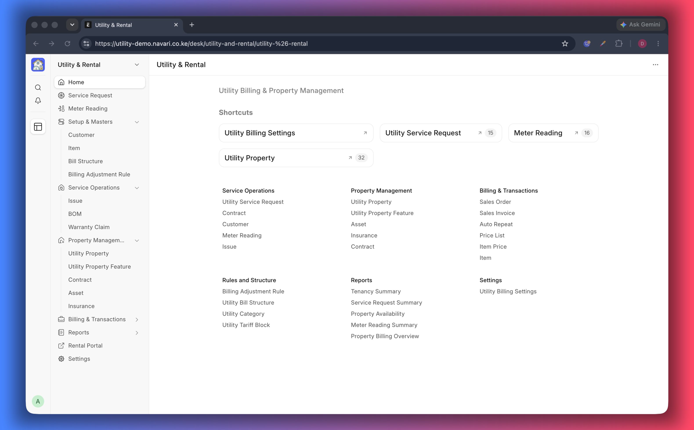

# Overview

Utility Billing & Property Management adds two connected modules to ERPNext:

- **Utility billing** — read meters, price consumption with tariffs and turn the
  readings into sales orders, invoices and receipts.
- **Property management** — register buildings and units, take tenant enquiries,
  sign contracts and bill rent and utilities on a single customer record.

This is the first of fourteen short guides; the [guide index](./README.md) lists
them all and points to the one for each task.

It is built for water, electricity, gas and waste providers, landlords, estate
managers and property developers.

## Who uses it

| Role                       | What they do                                               |
| -------------------------- | ---------------------------------------------------------- |
| Front desk / letting agent | Take enquiries, book units, record deposits                |
| Meter reader / operations  | Record readings, assign meters, handle connection requests |
| Billing clerk              | Review and submit orders and invoices, apply adjustments   |
| Finance                    | Collect payments, follow receivables and penalties         |
| Tenant / customer          | Self-service on the customer portal                        |

## The two journeys

### A. Utility connection and metered billing

1. A customer or lead asks for a connection — create a **Utility Service Request**.
2. Agree the scope (site survey, bill of materials) and the fees on the request.
3. Assign a meter number to the customer.
4. Every cycle, record a **Meter Reading**. Usage is _current reading − previous
   reading_.
5. On submit, the usage is priced from the customer's price list and a **Sales
   Order** is raised automatically.
6. The order is billed (**Sales Invoice**) and paid — in the office or by the
   tenant from the portal.

### B. Tenancy — from enquiry to rent

1. Capture the enquiry and the unit(s) the tenant wants on a **Utility Service
   Request**.
2. Collect the deposit or booking payment with a **Sales Order** (optional, or
   required — see [Settings](./01-Settings.md)).
3. Sign a **Contract** listing the units, the lease period and the rate
   adjustments.
4. Bill rent every cycle — by **Auto Repeat** or by **Item Price** schedule,
   depending on your setting.
5. Bill utilities per unit from meter readings, on the same customer.
6. Apply increments, late-payment penalties and write-offs with a **Billing
   Adjustment Rule**.
7. Tenants follow everything — invoices, meter readings, receipts and support
   tickets — in the [Customer Portal](./12-Customer-Portal.md).

## Records you will work with

| Record                          | What it holds                                                                |
| ------------------------------- | ---------------------------------------------------------------------------- |
| **Utility Billing Settings**    | How documents are created, what is required before billing, how rent repeats |
| **Utility Property**            | A building or a lettable unit, its size, amenities and gallery               |
| **Utility Service Request**     | The enquiry: who, which unit, which services, what it costs                  |
| **Utility Bill Structure**      | A reusable template of utility charges                                       |
| **Contract**                    | The signed lease: units, period, rent and adjustment rule                    |
| **Billing Adjustment Rule**     | Increments, penalties and the accounts they post to                          |
| **Meter Reading**               | Previous and current readings, usage and tariff blocks                       |
| **Sales Order / Sales Invoice** | Deposits, rent and utility charges to bill and collect                       |

Meter numbers, utility items, price lists and customers are standard ERPNext
records, so there is nothing new to learn for them.

## Documentation map

| #   | Guide                                                          | Read it when                                  |
| --- | -------------------------------------------------------------- | --------------------------------------------- |
| 00  | Overview                                                       | You are new to the app                        |
| 01  | [Settings](./01-Settings.md)                                   | You are setting the app up                    |
| 02  | [Properties](./02-Properties.md)                               | You register buildings and units              |
| 03  | [Property Management](./03-Property-Management.md)             | You want the tenancy journey end to end       |
| 04  | [Service Requests](./04-Service-Requests.md)                   | You take enquiries and connection requests    |
| 05  | [Bill Structures](./05-Bill-Structures.md)                     | You repeat the same charges often             |
| 06  | [Contracts](./06-Contracts.md)                                 | You sign leases                               |
| 07  | [Billing Adjustment Rules](./07-Billing-Adjustment-Rules.md)   | You review rent or charge penalties           |
| 08  | [Rent Billing](./08-Rent-Billing.md)                           | You set up recurring rent                     |
| 09  | [Meter Readings](./09-Meter-Readings.md)                       | You read meters and bill usage                |
| 10  | [Sales Orders and Invoices](./10-Sales-Orders-and-Invoices.md) | You check what a tenant is billed             |
| 11  | [Reports](./11-Reports.md)                                     | You review occupancy, tenancy and consumption |
| 12  | [Customer Portal](./12-Customer-Portal.md)                     | You give tenants self-service                 |
| 13  | [Demo Data](./13-Demo-Data.md)                                 | You want sample data to explore or train on   |

## Getting started checklist

1. Install the app on your site (see the repository README).
2. Open **Utility Billing Settings** and choose the document states you want —
   the portal only shows submitted documents.
3. Create the utility **Items** you sell (water, electricity, sewer, rent) and
   tick **Is Utility Item** on the ones billed from meter readings.
4. Set up **Price Lists** and **Item Prices**, including tariff blocks if you
   bill in tiers.
5. Register your **Properties** — buildings first, then the units inside them.
6. Add customers and link a portal user to each tenant.
7. Optionally generate [Demo Data](./13-Demo-Data.md) to explore every screen
   before entering live records.

---
