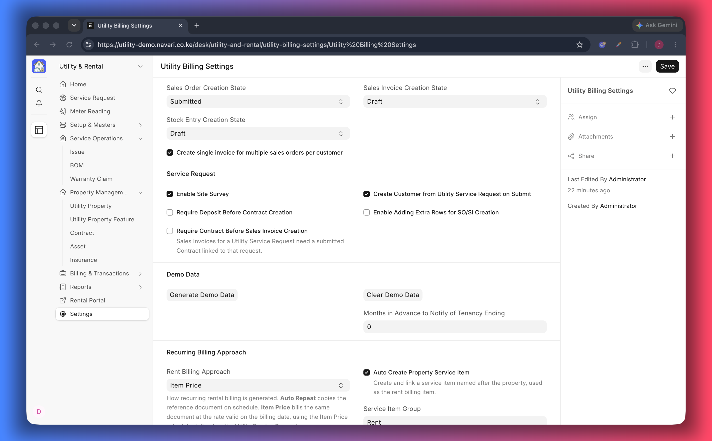

# Settings

**Utility Billing Settings** decides how the app behaves for the whole site: in
which state documents are created, what must exist before you can bill, and how
rent repeats. Set it up once, before you enter live records.

## Sales and stock documents

| Setting                                                          | What it does                                                       | What to choose                                                                                              |
| ---------------------------------------------------------------- | ------------------------------------------------------------------ | ----------------------------------------------------------------------------------------------------------- |
| **Sales Order Creation State**                                   | Whether utility Sales Orders are created as _Draft_ or _Submitted_ | _Submitted_ when the office bills without a second review; _Draft_ when someone must check each order first |
| **Sales Invoice Creation State**                                 | The same choice for invoices                                       | Keep it equal to the order state so both move together                                                      |
| **Stock Entry Creation State**                                   | State of stock entries created by the app                          | Leave as it is unless your store needs approval                                                             |
| **Create single invoice for multiple sales orders per customer** | Merges all open orders of a customer into one invoice              | Enable when a tenant receives several orders (rent + utilities) and should get one bill                     |

> The customer portal lists only **submitted** orders and invoices. If a tenant
> reports that nothing is showing, check these two states first.

## Service requests

| Setting                                                    | What it does                                                                                  |
| ---------------------------------------------------------- | --------------------------------------------------------------------------------------------- |
| **Create Customer from Utility Service Request on Submit** | Creates the customer automatically from the enquiry, so the front desk does not type it twice |
| **Enable Adding Extra Rows for SO/SI Creation**            | Lets you add extra lines while generating an order or invoice from a request                  |
| **Enable Site Survey**                                     | Adds the site survey step before a contract or document is created                            |
| **Require Deposit Before Contract Creation**               | Blocks the contract until the deposit is collected                                            |
| **Require Contract Before Sales Invoice Creation**         | Blocks invoicing until a signed contract exists                                               |
| **Require Signed Contract**                                | Makes a submitted, signed contract the only proof accepted before invoicing                   |

Use the last three to enforce policy: a lease cannot start unpaid, rent cannot be
billed without a contract, and a contract must actually be signed.

## Tenancy notices

| Setting                                           | What it does                                                                             |
| ------------------------------------------------- | ---------------------------------------------------------------------------------------- |
| **Months in Advance to Notify of Tenancy Ending** | How early the office is reminded that a lease is ending — three months is a common value |

## Cost centres and deferred posting

| Setting                              | What it does                                                                                |
| ------------------------------------ | ------------------------------------------------------------------------------------------- |
| **Auto Create Property Cost Center** | Creates a cost centre for each property so rent and utilities can be reported per unit      |
| **Default Parent Cost Centers**      | The company and parent cost centre those new cost centres are created under                 |
| **Enable Deferred Posting**          | Spreads income over the periods it belongs to instead of booking it all on the invoice date |
| **Deferred Accounts**                | The deferred income account per company, with the number of months to spread over           |

Leave deferred posting off unless your accounting policy requires it; turning it
on changes how invoices are posted from that point, not invoices already
submitted.

## Recurring rent

| Setting                               | What it does                                                                                                        |
| ------------------------------------- | ------------------------------------------------------------------------------------------------------------------- |
| **Rent Billing Approach**             | **Auto Repeat** copies a reference document on schedule; **Item Price** bills at the rate valid on the billing date |
| **Auto Create Property Service Item** | Creates the rent item named after a property (on by default)                                                        |
| **Service Item Group**                | Item group used for those property items                                                                            |
| **Item Price UOM**                    | Unit of measure used when Item Prices are generated from a rent schedule                                            |
| **Default Price List**                | Price list used on a service request when neither the request nor the customer has one                              |

> Pick **Item Price** if rents change over time or one document should pick up
> new rates automatically. Pick **Auto Repeat** if you prefer copies of a
> reference invoice. The full workflow is in
> [Rent Billing](./08-Rent-Billing.md).

## Demo data

| Button                 | What it does                                                                                |
| ---------------------- | ------------------------------------------------------------------------------------------- |
| **Generate Demo Data** | Builds a complete sample company with properties, tenants, contracts, readings and invoices |
| **Clear Demo Data**    | Removes the demo company and everything generated with it                                   |

See [Demo Data](./13-Demo-Data.md).

## A recommended setup for a new site

1. Set both sales document states to **Submitted** if tenants should see bills
   immediately.
2. Enable **Create Customer from Utility Service Request on Submit** so the desk
   only types the tenant once.
3. Enable **Require Contract Before Sales Invoice Creation** if rent must never
   be billed without a signed lease.
4. Choose the **Rent Billing Approach** that matches how you review rent.
5. Set the **Default Price List** so requests are priced from the first row.

## If something does not work

- **No invoice was created from a request** — check _Require Contract Before
  Sales Invoice Creation_ and whether the contract is signed.
- **Tenants see no bills in the portal** — the documents are still drafts. Set
  the creation states to _Submitted_, or submit the documents.
- **A property has no rent item** — _Auto Create Property Service Item_ is off,
  or the item was never created; see [Rent Billing](./08-Rent-Billing.md).

---
