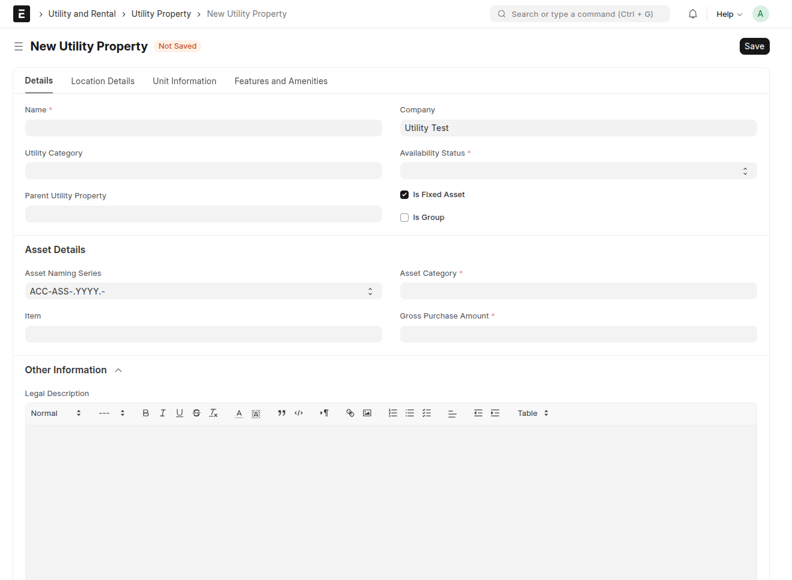

# Property Management

This guide is the map of the tenancy journey: from a tenant walking in, to a
signed lease, to rent and utility bills arriving every month. Each step links to
its own guide.

## The journey at a glance

| Step | You do                                  | Record you use                                                       |
| ---- | --------------------------------------- | -------------------------------------------------------------------- |
| 1    | Take the enquiry and pick the unit      | [Utility Service Request](./04-Service-Requests.md)                  |
| 2    | Collect the deposit or booking fee      | Sales Order (from the request)                                       |
| 3    | Sign the lease                          | [Contract](./06-Contracts.md)                                        |
| 4    | Set the rent and its increases          | [Item Prices](./08-Rent-Billing.md) or Auto Repeat                   |
| 5    | Bill rent every cycle                   | Sales Invoice                                                        |
| 6    | Bill water, electricity and other usage | [Meter Reading](./09-Meter-Readings.md)                              |
| 7    | Review and collect                      | [Reports](./11-Reports.md) and the [portal](./12-Customer-Portal.md) |

## 1. The tenant

A tenant is a **Customer**, exactly like any other customer in ERPNext. That is
what keeps rent, utility bills, deposits and payments on one ledger.

- Create the customer from the service request, or beforehand in CRM.
- Give the tenant a portal login if they should see their bills online — link it
  through the customer's **Portal Users** table.
- Commercial tenants can sit in their own customer group, which also drives the
  price list (residential versus commercial tariffs).

## 2. The units

Units are registered as [Utility Properties](./02-Properties.md). A lease can
cover more than one unit — for example a flat plus a parking bay plus a shop
below it — and each unit is billed separately inside one contract.

## 3. The enquiry

Every tenancy starts with a **Utility Service Request**: who the tenant is, which
units they want, the period they want them for, and what they should be charged.
The request is also where you bill the deposit and where you can generate the
rent schedule.

> Contract and deposit can be made mandatory before invoicing in
> [Settings](./01-Settings.md). Most operators require both.

## 4. The lease

The **Contract** is the signed agreement. It lists the units, the lease period,
which units are active, and the rule that raises the rent over time. Contracts
also decide what the portal shows the tenant as _Active_ or _Reserved_.

## 5. Recurring rent

Rent repeats in one of two ways, chosen in [Settings](./01-Settings.md):

- **Auto Repeat** — a reference invoice or order is copied on schedule and
  increments are applied when a repeat completes.
- **Item Price** — a dated schedule of rates per unit is generated from the
  lease, and billing simply uses the rate valid on the billing date.

Both approaches are described in [Rent Billing](./08-Rent-Billing.md).

## 6. Utilities

Consumption is billed per unit from **Meter Readings**. A reading prices the
usage with the tenant's price list — including tiered tariff blocks — and raises
a Sales Order. Utility and rent charges can be billed together or separately;
see [Sales Orders and Invoices](./10-Sales-Orders-and-Invoices.md).

## 7. Changes during a tenancy

| Situation                     | What to do                                                                               |
| ----------------------------- | ---------------------------------------------------------------------------------------- |
| Rent review / annual increase | Maintain the [Billing Adjustment Rule](./07-Billing-Adjustment-Rules.md) on the contract |
| Late payment                  | Penalties are charged by that same rule                                                  |
| Tenant adds a unit            | Add a row to the contract's requested properties                                         |
| Unit vacated mid-term         | Clear **Is Active** on that contract row and set the property status to _Available_      |
| Lease renewal                 | Extend the contract dates and refresh the rent schedule                                  |
| Meter replaced                | Record the new meter number on the customer and start a fresh reading                    |

## What tenants see

Tenants with a portal login can follow their active and reserved units, download
invoices, pay online, see their meter readings and raise support tickets. See
[Customer Portal](./12-Customer-Portal.md).

---
