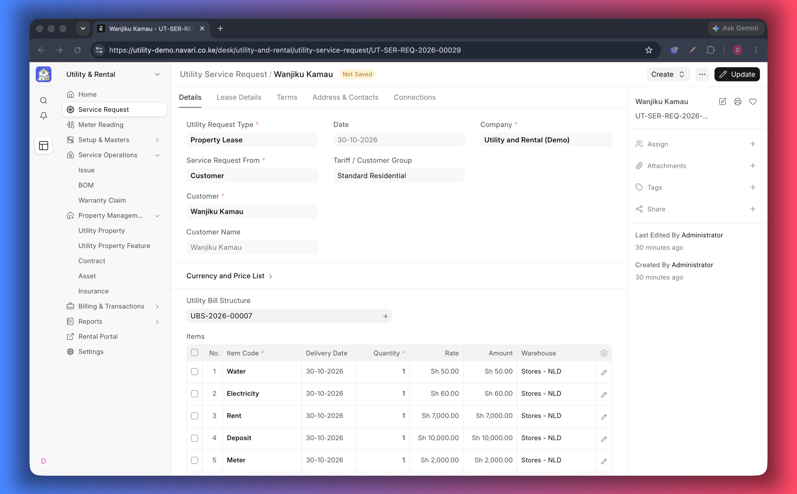
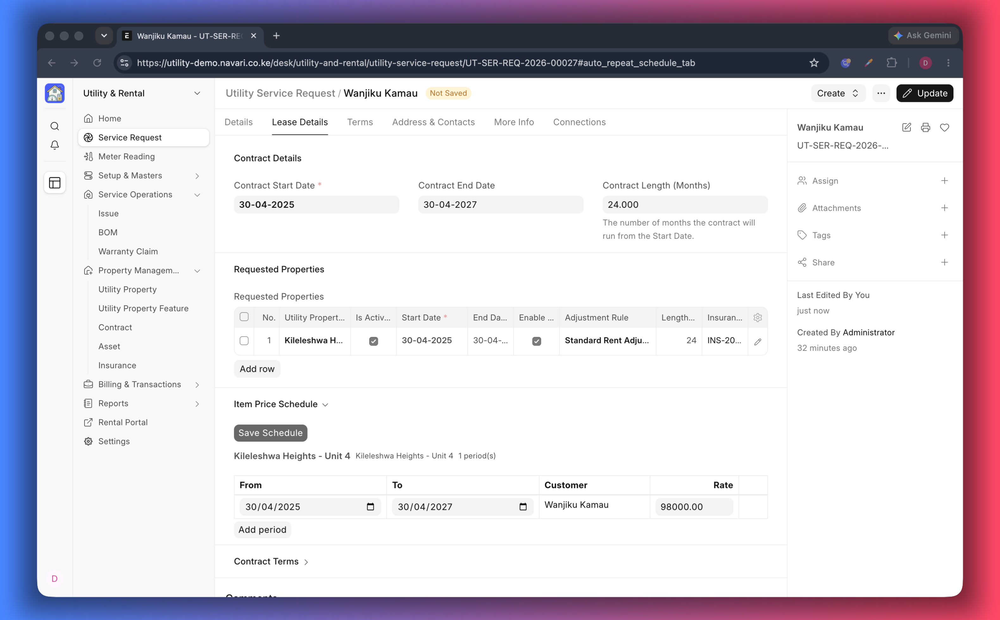
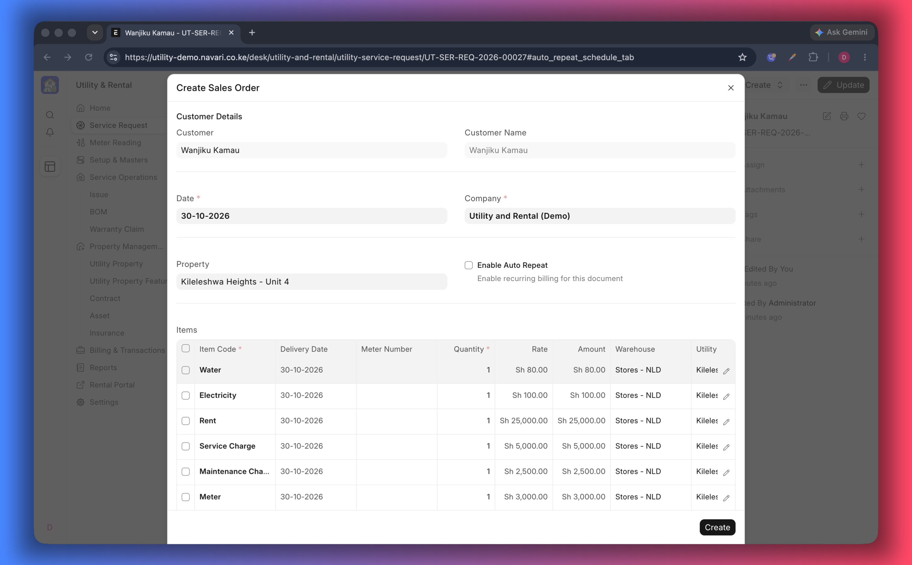
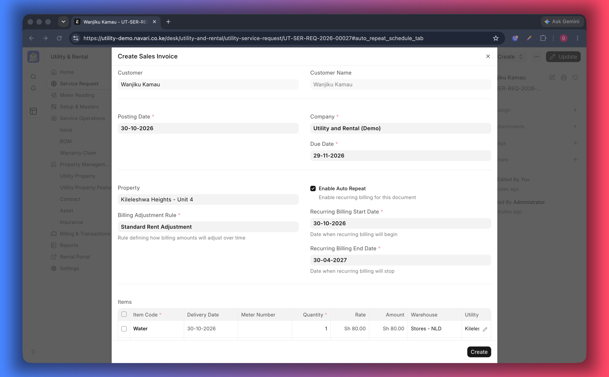

# Service Requests

A **Utility Service Request** is the form the front desk fills in when someone
wants something: a water or electricity connection, a unit to rent, or both. It
holds the customer, the unit(s), the services, the amounts and the dates, and it
is the starting point for the deposit order, the contract and the invoices.

## Before you start

- The customer exists, or you are ready to let the request create it (see
  **Create Customer from Utility Service Request on Submit** in
  [Settings](./01-Settings.md)).
- The unit(s) are registered as [properties](./02-Properties.md).
- The items you bill are available, with prices in the price list you will use.

## Create a request

1. Go to **Utility Service Request → New**.
2. Choose **Service Request From** — _Customer_, _Lead_ or _Prospect_ — and pick
   the **Party Name**. For a new customer, enter the name and
   **NRC/Passport No.** and the customer is created on submit when the setting is
   on.
3. Set the **Utility Request Type** (new connection, disconnection, upgrade …),
   the **Company**, the **Tariff / Customer Group**, the **Currency** and the
   **Price List**.
4. On **Contract Details**, enter the **Contract Start Date** and **Contract End
   Date** — these dates flow into the contract and into the rent schedule.
5. On **Lease Details**, add the units the tenant wants to the **Requested
   Properties** table.
6. Check the **Items** table, which now lists each unit's rent plus any utility or
   one-time charges.
7. On **Coordinates**, record the connection details for utility work —
   connection size, water network and pipe type/distance.
8. Add **Terms and Conditions** if you use them, then **Save** and **Submit**.

## The tabs

### Details

Customer, request type, tariff group, currency, price list, cost center and
project. The **Request Status** field shows how far the survey and BOM steps have
gone (_Site Survey Created_, _Site Survey Completed_, _BOM Created_, _BOM
Completed_).

### Lease Details — requested properties

Each row is one unit in the lease:

| Column                       | Meaning                                                                                                        |
| ---------------------------- | -------------------------------------------------------------------------------------------------------------- |
| **Utility Property**         | The unit being requested (required)                                                                            |
| **Is Active**                | Untick to suspend billing for that unit without removing it                                                    |
| **Start Date / End Date**    | The lease period for that unit                                                                                 |
| **Contract Length (Months)** | Duration, used by reports and rules                                                                            |
| **Insurance**                | Optional insurance document covering the unit                                                                  |
| **Adjustment Rule**          | The rule that raises the rent for that unit — see [Billing Adjustment Rules](./07-Billing-Adjustment-Rules.md) |

### Items

The **Items** table is what the customer will be billed for: rent for each unit,
connection or inspection fees, and recurring service charges.

- Adding a unit to **Requested Properties** adds that unit's rent item
  automatically. Removing the unit removes its row again; re-adding it never
  duplicates a row.
- Rows you add by hand are left untouched.
- Rates come from the document's **Price List**. The price list defaults from the
  customer or the customer's group, and changing it re-prices the rows.
- The table can stay empty if you are not ready to price the request; items can
  be added later on the request, the order or the invoice.
- If you link a **Utility Bill Structure**, its charges are pulled in as rows —
  see [Bill Structures](./05-Bill-Structures.md).

### Coordinates

Connection size, water network and pipe type/distance, for the engineering team.

### Address & Contacts, Terms

The customer's address and contact cards, and the terms printed on the request.

## Next steps from the request

Use the **Create** menu once the request is submitted:

- **Sales Order / Deposit** — bills the deposit or booking fee. With the _Item
  Price_ rent approach this opens a normal Sales Order form pre-filled from the
  request; otherwise a small dialog asks for the amounts and dates.
- **Sales Invoice** — bills the first period. With the _Item Price_ approach it
  opens a normal invoice pre-filled from the request.

- **Contract** — drafts the lease for the requested units; see
  [Contracts](./06-Contracts.md).
- **Property** — registers a unit you have not created yet.

## Rent schedules for the whole lease

When **Rent Billing Approach** is _Item Price_, use **Define → Item Prices** on a
submitted request to generate the rent of every period at once: pick the unit, a
starting rate, the lease period and an adjustment rule, preview the periods and
create the Item Prices. The schedule is stored on the request's **Item Price
Schedule** table and can be reviewed in the **Item Price Summary**.

The full procedure is in [Rent Billing](./08-Rent-Billing.md).

## If something does not work

- **A unit is missing from Items** — save the request again; the row is added
  from the requested property. Check the unit is not a group property.
- **Rates are empty or wrong** — set the **Price List** on the request or on the
  customer, and confirm the item has an Item Price in that list.
- **The deposit order cannot be created** — the request is still a draft, or a
  required setting (site survey, deposit) is not satisfied yet.

---
