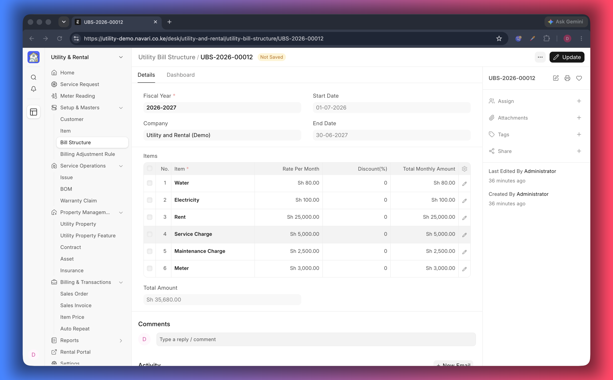

# Bill Structures

A **Utility Bill Structure** is a saved list of charges you bill again and again —
for example a standard connection package with a meter fee, an inspection fee and
a refundable deposit. Instead of typing those rows on every request, link the
structure and the rows appear.

## Create a structure

1. Go to **Utility Bill Structure → New**.
2. Choose the **Fiscal Year** the structure belongs to.
3. Set the **Start Date** and **End Date** of the period it covers.
4. Optionally add a **Cost Center** and a **Project** so the revenue is
   bookkept in the right place.
5. In **Items**, add one row per charge: the **Item**, its **Amount** and, if
   you give one, a **Discount (%)**. The **Total** of each row is calculated
   after the discount.
6. Check the **Total Amount** at the foot of the table, then save.

## Use it on a request

1. Open or create a [Utility Service Request](./04-Service-Requests.md).
2. Pick the structure in **Utility Bill Structure**.
3. The structure's charges are added to the **Items** table with their discounts
   already applied.
4. Price the rest of the request as usual, then submit.

## When a structure is the right tool

- **Standard connection packages** — the same survey and connection charges for
  every new customer.
- **Service bundles** — a fixed monthly bundle of water, sewer and waste charges.
- **Promotions** — a package with built-in discounts for a season or a project.

If each customer needs different amounts, skip the structure and enter the items
directly on the request; both ways coexist.

## Good to know

- A structure is a template. Changing it later does not change requests that
  already used it — those requests keep the items they received.
- Create one structure per fiscal year if your charges change annually, so old
  requests still explain themselves.
- Amounts are per charge, not per unit of measure; put the unit price and
  quantity in the item's price list if the charge varies by quantity.

## If something does not work

- **The structure adds nothing to the request** — it has no items, or the date
  range does not cover the request date.
- **Amounts look doubled** — the same items were added by hand before linking
  the structure; remove the manual rows.

---
