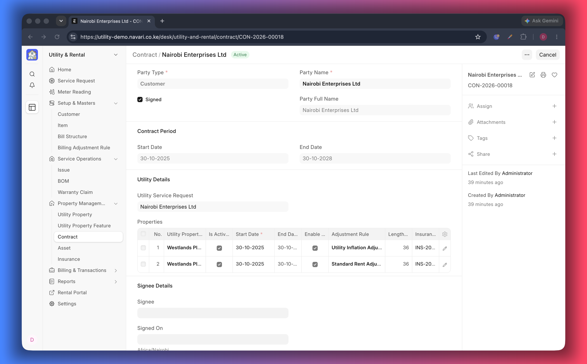
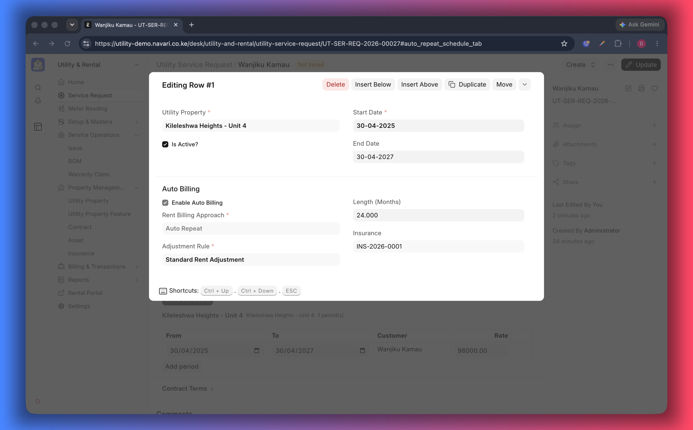

# Contracts

A **Contract** is the signed lease. It says which units the tenant has, for how
long, at what rent and how that rent changes. Billing, the portal's _Active_ and
_Reserved_ badges and the tenancy reports all read from it.

## Create a contract

1. Open the [Utility Service Request](./04-Service-Requests.md) the tenant
   signed up through.
2. Choose **Create → Contract**. The customer, the units and the lease dates are
   carried over and the **Utility Service Request** field on the contract points
   back to the request.
3. Check the **Start Date** and **End Date**. They are fetched from the request —
   change them on the request if they are wrong, so both documents agree.
4. Review the **Requested Properties** table (below) and set the adjustment rule
   for each unit.
5. Attach the signed copy, then save and submit.

## Requested properties

Each row is one unit in the lease:

| Column                       | What it means                                                                                                          |
| ---------------------------- | ---------------------------------------------------------------------------------------------------------------------- |
| **Utility Property**         | The unit this row covers (required)                                                                                    |
| **Is Active**                | Whether the unit is currently billed. Untick to pause invoicing and adjustments for that unit without ending the lease |
| **Start Date / End Date**    | The period this unit is billed for                                                                                     |
| **Contract Length (Months)** | Duration of the row, for reports and rules                                                                             |
| **Insurance**                | Optional insurance covering the unit during the lease                                                                  |
| **Adjustment Rule**          | The rule that raises the rent of this unit — see [Billing Adjustment Rules](./07-Billing-Adjustment-Rules.md)          |

> The tenant portal marks an allocation **Reserved** while its contract is not
> signed, **Active** once signed and running, and moves it to history when the
> row is inactive or the lease has ended.

## Day-to-day tasks

| Task                       | What to do                                                                   |
| -------------------------- | ---------------------------------------------------------------------------- |
| Tenant takes a second unit | Add a row to **Requested Properties** and set its dates and rule             |
| Unit handed back early     | Clear **Is Active** on that row, then set the property status to _Available_ |
| Rent review                | Update the **Adjustment Rule** on the row                                    |
| Renewal                    | Amend the contract end date and extend the rent schedule                     |
| Insurance renewed          | Update the **Insurance** link                                                |

## How the contract drives billing

- **Auto Repeat** — the reference invoice/order is copied on schedule and the
  adjustment rule is applied when a repeat completes.
- **Item Price** — rates for every period are generated from the lease, and
  billing uses the rate valid on that date. See
  [Rent Billing](./08-Rent-Billing.md).

Both approaches are set site-wide in [Settings](./01-Settings.md). Utilities are
billed separately from meter readings and are not affected by the rent approach.

## If something does not work

- **Invoices are blocked** — _Require Contract Before Sales Invoice Creation_ is
  on and this contract is missing or still a draft.
- **No invoices are repeating** — check the **Is Active** flag on the row and
  whether the Auto Repeat or rent schedule covers the current period.
- **The portal shows the unit as history** — the row is inactive or its end date
  has passed.

---
