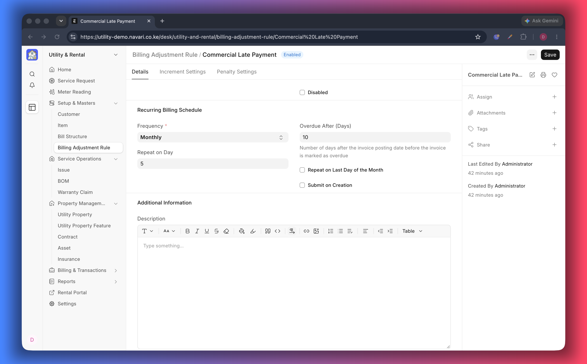
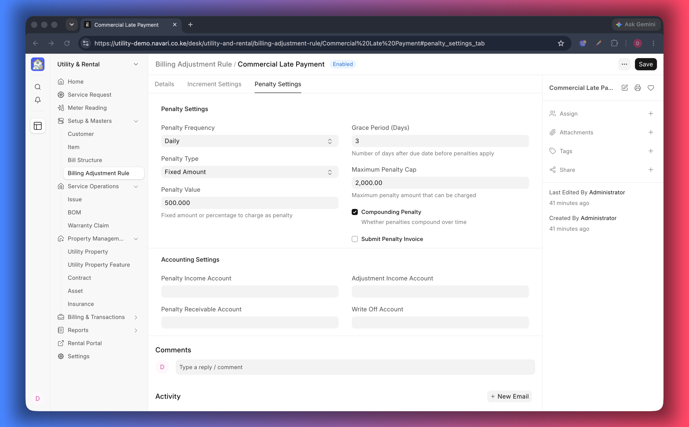

# Billing Adjustment Rules

A **Billing Adjustment Rule** describes how a recurring charge changes over time
and what happens when a payment is late: the yearly rent increment, the late
penalty, the grace period, and the accounts those amounts post to. Attach one
rule per unit on a [Contract](./06-Contracts.md).

## Create a rule

1. Go to **Billing Adjustment Rule → New**.
2. Give the rule a **Rule Name** your team will recognise, for example
   _Residential — 8% yearly_.
3. Fill in the increment settings and, if you charge them, the penalty settings.
4. Choose the accounts on the accounting section.
5. Save. Leave **Disabled** unticked to keep the rule in use; tick it to stop the
   rule without deleting it.

## Increment settings

| Field                                  | What it controls                                                                                                                 |
| -------------------------------------- | -------------------------------------------------------------------------------------------------------------------------------- |
| **Frequency**                          | How often the rent is reviewed — Daily, Weekly, Monthly, Quarterly, Half-yearly or Yearly                                        |
| **Increment Interval (Months)**        | Months between two increases, e.g. `12` for a yearly review                                                                      |
| **Increment Percentage**               | How much the amount grows at each interval, e.g. `5` for 5%                                                                      |
| **Effective After (Months)**           | Grace period before the first increase — use `0` to increase from the first review                                               |
| **Maximum Billing Adjustment Cap (%)** | The most the charge may ever move, whatever the frequency                                                                        |
| **Billing Adjustment Basis**           | **Original Amount** grows in a straight line from the starting rent; **Last Adjusted Amount** compounds on the previous increase |

> Example: a 5% rule on 20,000 with an annual interval and _Original Amount_
> gives 21,000, 22,000, 23,000. The same rule on _Last Adjusted Amount_ gives
> 21,000, 22,050, 23,152.50.

## Penalty settings

| Field                      | What it controls                                                           |
| -------------------------- | -------------------------------------------------------------------------- |
| **Grace Period (Days)**    | Days after the due date before a penalty is charged                        |
| **Penalty Type**           | **Fixed Amount** or **Percentage** of the overdue amount                   |
| **Penalty Value**          | The amount or the percentage                                               |
| **Maximum Penalty Cap**    | The most a penalty may reach                                               |
| **Penalty Frequency**      | Daily, Weekly, Monthly or One-time                                         |
| **Compounding Penalty**    | Whether penalties build on previous penalties                              |
| **Submit Penalty Invoice** | Submits the penalty invoice automatically instead of leaving it as a draft |

Keep the grace period generous enough for your payment channels to clear, and set
a cap whenever you bill a percentage — it prevents a small arrears balance from
growing without limit.

## Accounting

| Field                                 | Where the amount is posted          |
| ------------------------------------- | ----------------------------------- |
| **Penalty Income Account**            | Income from late penalties          |
| **Penalty Receivable Account**        | Receivable tracked for penalties    |
| **Billing Adjustment Income Account** | Income from rent increments         |
| **Write-Off Account**                 | Adjustments you decide to write off |

Leave a field empty to use the company default.

## Where the rule is used

- On each row of a contract's **Requested Properties**, which lets one tenant
  have different rules per unit.
- When generating a rent schedule with **Define → Item Prices** on a service
  request, where the rule pre-fills the increase settings.

## If something does not work

- **Rent never increases** — the rule is disabled, the row has no rule, or
  _Effective After (Months)_ pushes the first increase beyond the period you are
  billing.
- **Penalties are too high** — lower the percentage or set a **Maximum Penalty
  Cap**; check the frequency is not _Daily_ where you meant _One-time_.
- **Penalty invoices stay in draft** — enable **Submit Penalty Invoice** on the
  rule.

---
