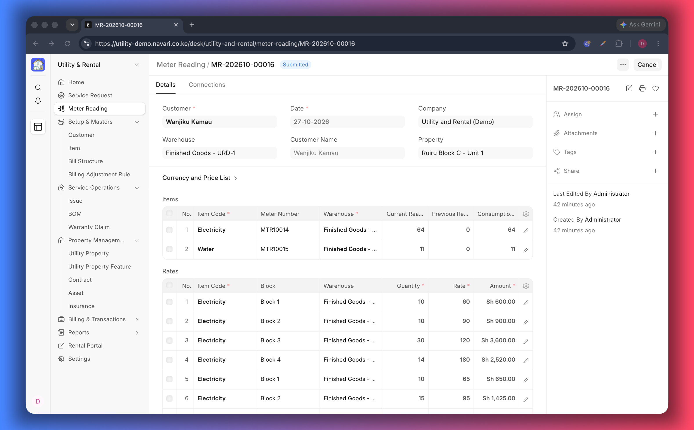

# Meter Readings

A **Meter Reading** turns consumption into a bill. You record what the meter
shows today, the app works out the usage against the previous reading, prices it
with the customer's tariff and raises a Sales Order.

## Before you take readings

- The utility **Item** is marked **Is Utility Item**.
- **Meter numbers** are recorded as serial numbers, so each meter can be traced
  to the customer it serves. When a meter is installed, replaced or swapped,
  update the serial on the customer first.
- The customer has a **Price List** with Item Prices, and tariff blocks if you
  bill in tiers (for example the first 10 units at one rate and the rest at
  another).

## Record a reading

1. Go to **Meter Reading → New**.
2. Choose the **Customer**. The **Property** is filled from the customer when it
   is known.
3. Check the **Date**, **Company**, **Currency**, **Price List**, **Cost Center**
   and **Project**.
4. In **Items**, add one row per meter: the **Utility Item**, the **Meter Number**
   and the **Current Reading**.
5. The **Previous Reading** is looked up for you from the last reading invoiced
   to that customer for that meter, and **Consumption** is calculated as
   _current − previous_.
6. Check the **Rates** tab, which previews the tariff blocks and rates that will
   be applied.
7. **Save** and **Submit**. A Sales Order is created automatically, in the state
   chosen in [Settings](./01-Settings.md).

## The form

| Field                               | What to enter                                                |
| ----------------------------------- | ------------------------------------------------------------ |
| **Customer / Customer Name**        | Who is being billed                                          |
| **Date**                            | The date the meter was read                                  |
| **Property**                        | The unit the meter serves                                    |
| **Currency / Price List**           | Where the rates come from                                    |
| **Company / Cost Center / Project** | How the revenue is booked                                    |
| **Warehouse**                       | Optional, when stock items are involved                      |
| **Rates**                           | Read-only preview of the tariff blocks used for the estimate |

Each **item row** holds the utility item, the meter number, the current reading
and — calculated — the previous reading and the consumption. The **tariff rate
rows** show which block each portion of the consumption falls into and at what
rate.

## What happens on submit

- Consumption is calculated per item.
- The consumption is split across the tariff blocks of the price list and priced.
- A **Sales Order** is raised with one line per item, carrying the meter reading
  and the block information, so the invoice can show exactly how the amount was
  built up.
- The reading appears in the tenant's portal with its consumption and block
  breakdown.

Then bill as usual: [Sales Order and Invoice](./10-Sales-Orders-and-Invoices.md).

## Correcting a reading

- Before submit, edit the rows freely.
- After submit, cancel the reading **and** the Sales Order it created, then record
  the reading again. Cancelling the reading alone does not cancel the order.
- If a meter was misread by a large margin, correct it the same way and explain
  the adjustment to the tenant.

## If something does not work

- **"Current reading cannot be lower than the previous reading"** — the number
  was mistyped, or the meter was replaced. Check the reading; if the meter is new,
  record it under the new meter number so it starts from zero.
- **The amount looks wrong** — check the customer's **Price List**, the Item
  Price and the tariff blocks; the **Rates** tab shows what was applied.
- **No Sales Order was created** — the reading is still a draft, or an order
  already exists for it.

---
