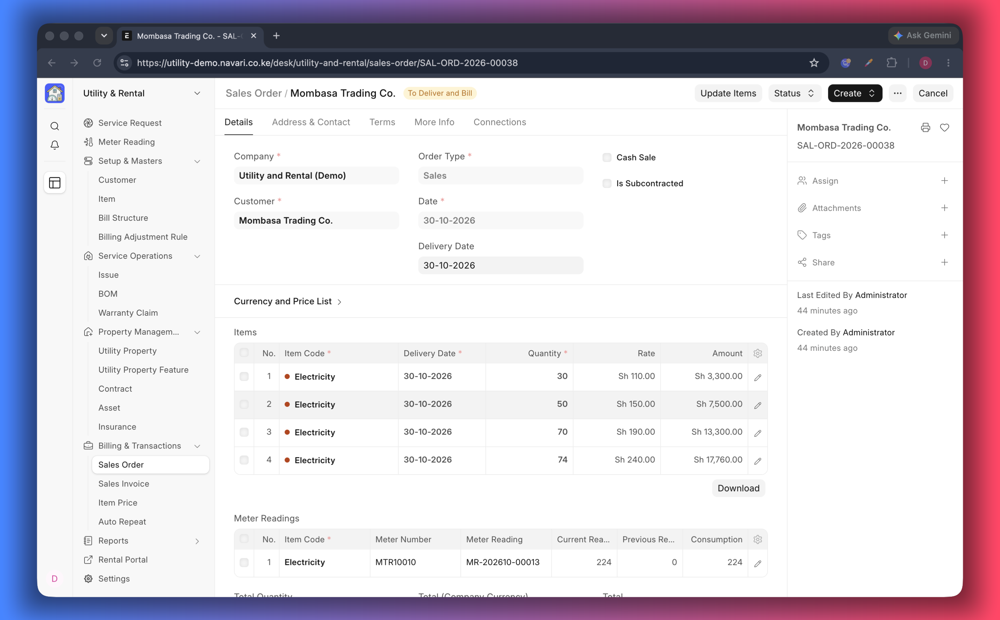
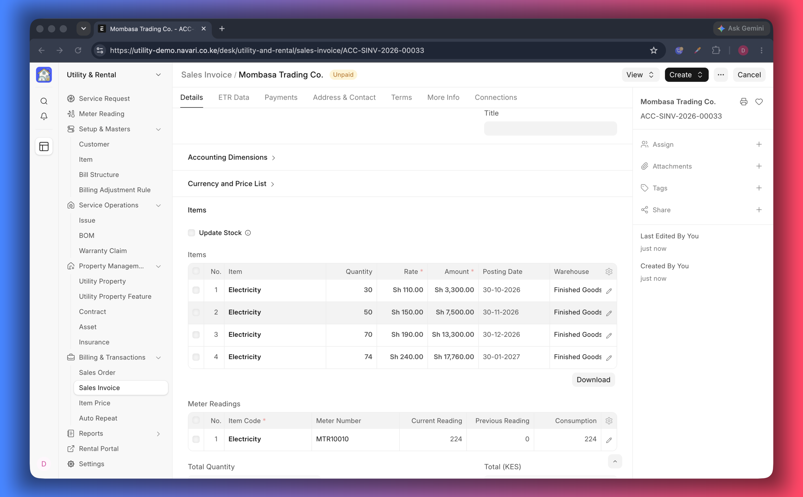
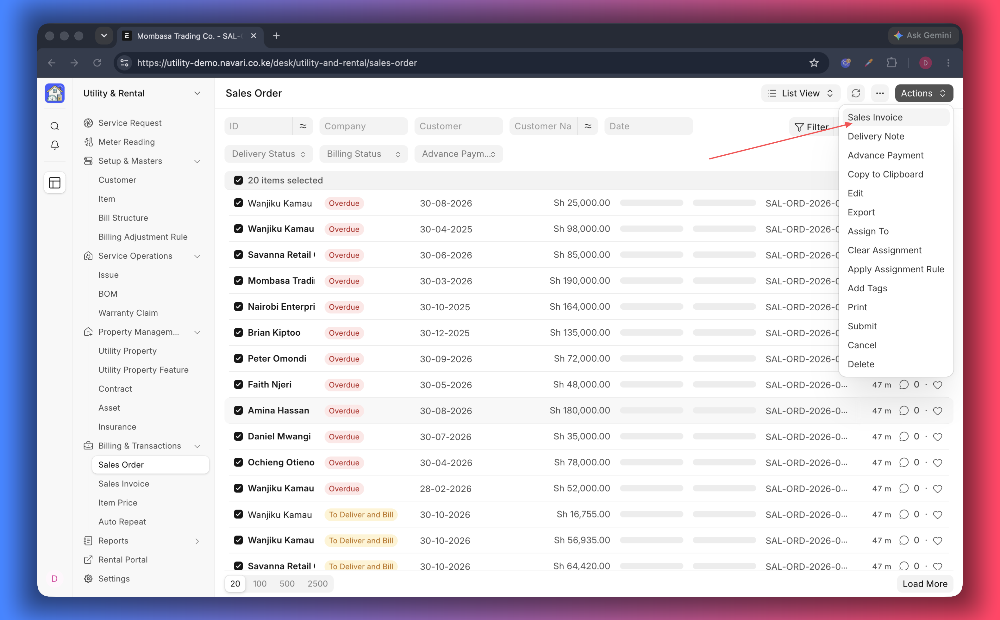

# Sales Orders and Invoices

Everything the customer owes ends up on a **Sales Order** and then a **Sales
Invoice** — deposits, rent, connection fees and metered consumption. They are
ordinary ERPNext documents with a few extra sections that explain how a utility
amount was built.

## The extra information you will see

### Meter readings

The **Meter Readings** table on the order and the invoice lists the readings that
produced the utility lines: the meter, the previous and current reading and the
usage. It is your evidence when a tenant questions a bill.

### Utility service request

The **Utility Service Request** field links the document back to the enquiry it
came from, so you can see the agreed scope, the units and the dates in one click.

### Tariff blocks on the items

Each item row carries the **tariff block** it was priced with. On a tiered
tariff, an invoice therefore shows one line per block — for example 10 units at
the first rate and 22 units at the second — instead of a single blended amount.

## Where the documents come from

| Source                                      | What you get                                         |
| ------------------------------------------- | ---------------------------------------------------- |
| [Meter Reading](./09-Meter-Readings.md)     | A Sales Order for the consumption, created on submit |
| [Service Request](./04-Service-Requests.md) | A deposit/booking order, or a first invoice          |
| [Contract](./06-Contracts.md)               | Recurring rent, by Auto Repeat or Item Price         |

## Reviewing an order before it is billed

1. Open the order and check the customer, the dates, the price list and the
   items.
2. Check the meter readings and tariff blocks where present.
3. Confirm the totals, then submit.
4. Choose **Create → Sales Invoice** to bill it.

With **Sales Order Creation State** set to _Draft_ in
[Settings](./01-Settings.md), orders wait for this review; with _Submitted_ they
are ready to bill immediately.

## Billing many orders at once

1. Open the **Sales Order** list and filter to the orders you want to bill — for
   example by customer group or posting date.
2. Tick the orders.
3. Choose **Actions → Sales Invoice** and confirm.

What happens next depends on **Create single invoice for multiple sales orders
per customer** in [Settings](./01-Settings.md):

- **On** — the selected orders are grouped by customer and billed as one invoice
  per customer, in a background job. Draft orders are listed and skipped; you are
  told when the job is queued.
- **Off** — ERPNext creates one invoice per order, as usual.

Refresh the list when the job finishes, and check the invoices before submitting
them if your creation state is _Draft_.

## Reading an invoice with a tenant

| Question            | Where to look                                                |
| ------------------- | ------------------------------------------------------------ |
| What was consumed?  | **Meter Readings** table                                     |
| Why this amount?    | The item lines, each with its tariff block and rate          |
| Which unit?         | The item description and the property on the service request |
| What is still owed? | **Outstanding Amount** at the foot of the invoice            |
| Has it been paid?   | The payment entries linked to the invoice                    |

## If something does not work

- **A utility line has no tariff block** — the item was priced without tiered
  rates; check the Item Price and price list.
- **The invoice is missing a meter reading** — the order was created by hand
  instead of from a reading, or the reading belongs to another customer.
- **Two invoices for the same period** — one order was billed twice; check the
  order's status before creating another invoice.

---
