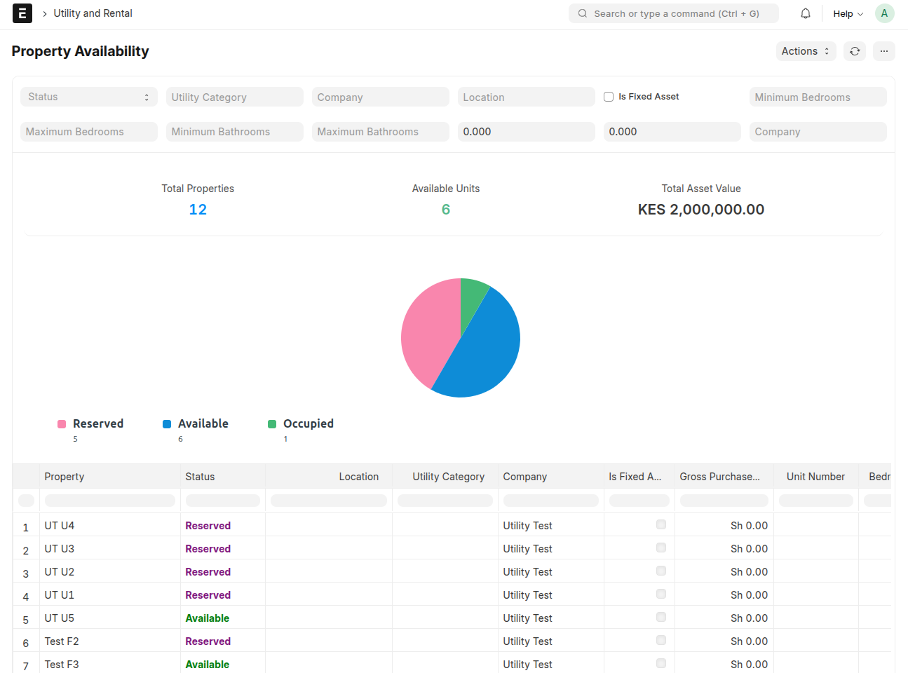
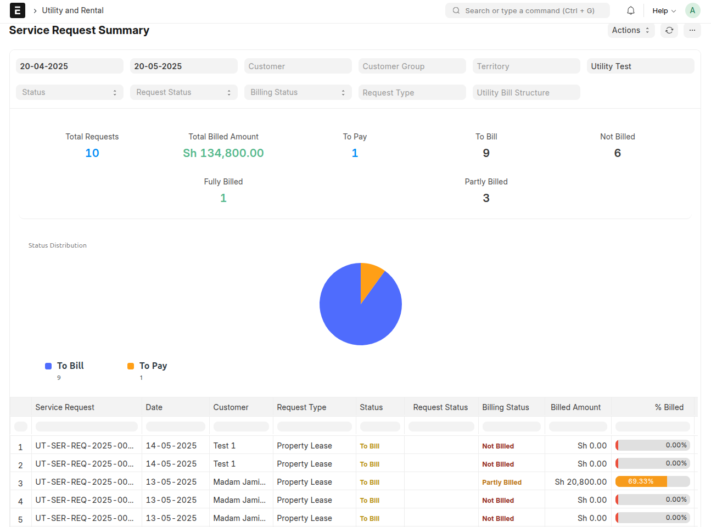
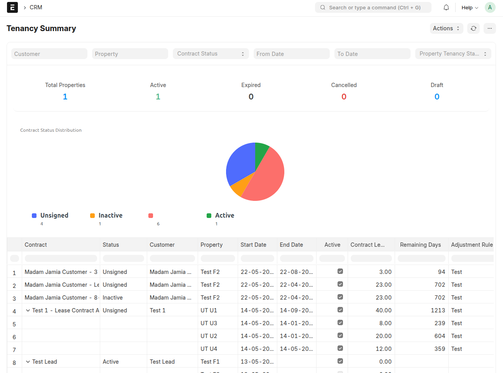
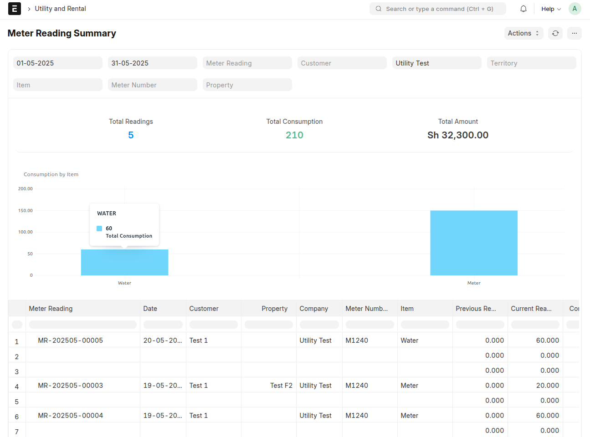

# Reports

Four reports answer the questions the office asks most often: what is free, what
are we working on, which tenancies are running, and how much was consumed. Each
opens from the **Reports** section of the workspace.

## Property Availability

**Answers:** which units can I offer today, and what is my portfolio worth?

- Every unit with its **availability status** — Available, Occupied, Reserved or
  Under Maintenance.
- Unit specifications: bedrooms, bathrooms and size.
- Total asset value of the properties in the report.
- Vacancy at a glance, by building and by unit type.

Use it before answering a letting enquiry, and at month end to review vacancy.

## Service Request Summary

**Answers:** where are our enquiries stuck, and what has been billed from them?

- Every request with its **utility request type** and its progress through survey
  and BOM.
- Which requests became contracts or orders and which are still open.
- Billing progress per customer group, so you can see the ones waiting on a
  deposit or a contract.

Use it in the weekly pipeline meeting, and to chase requests that never turned
into a lease.

## Tenancy Summary

**Answers:** which leases are running, which are ending, and which units do they
cover?

- Active and expired contracts with their remaining duration.
- The units and properties each contract covers.
- Contract adjustments and insurance coverage.

Use it ahead of renewals — filter to contracts ending within the next three
months — and to check that every occupied unit really has a signed contract.

## Meter Reading Summary

**Answers:** how much was consumed, in which tariff block, and billed for how
much?

- Consumption per utility item and per customer.
- The tariff blocks a reading was split into and the rates applied.
- The amounts generated for billing.

Use it to review unusual consumption (a leak shows up as a jump for one unit),
to reconcile billed amounts against readings, and to explain a bill to a tenant.

## Getting the most from the reports

- Run them from the workspace rather than from a list view, so the columns and
  totals are the ones designed for the question.
- Export to Excel or PDF when you need to share a period with management or with
  a tenant.
- Reports reflect submitted records; if a figure looks low, look for draft
  contracts, readings or invoices.

---
