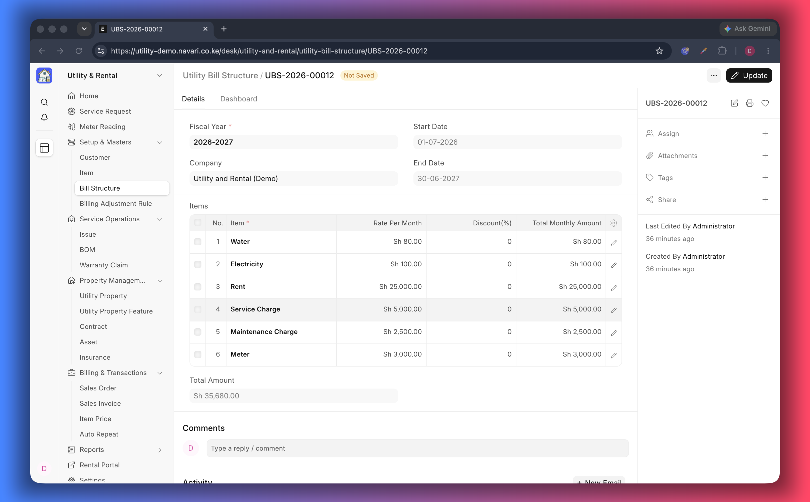

# 🧾 Utility Bill Structure

The **Utility Bill Structure** doctype is a configurable template used within the [Utility Billing](https://github.com/navariltd/utility-billing) app for ERPNext. It allows users to predefine billable utility items and related charges, which can then be reused and auto-filled in **Utility Service Requests**.

This reduces repetitive data entry and ensures billing consistency across similar requests for utilities such as water, electricity, or gas.

---

## 📋 Purpose

The Utility Bill Structure acts as a **template** for recurring utility billing formats. When a service provider initiates a **Utility Service Request**, this structure can be linked to automatically populate the necessary items, their amounts, and associated metadata like cost center and project.

---

## ✅ How to Use

1. Create a **Utility Bill Structure** with predefined utility items, amounts, and optional discounts.
2. Link this structure to a **Utility Service Request**.
3. Upon linking, all items and charges are auto-filled in the request.

---

## Calculate monthly bills

For monthly customer billing, use **Calculations and Charges** and a submitted **Bill Structure Assignment**. The reading date selects the assignment that applies to the customer. New assignments receive readable references such as `UBSA-2026-00001`; existing assignment references are retained.

- **Calculation Only** rows work out intermediate amounts. Give each one a Description and an Abbreviation so later rows can use its result. These rows do not require an Item and do not become charges.
- **Billable Item** rows produce the actual charges. Choose an Item, then a fixed amount or an Amount Formula.

Rows calculate from top to bottom. For example, at 15 units:

| Description | Abbreviation | Condition | Amount Formula | Row Type |
|---|---|---|---|---|
| First 10 units | W1 | `consumption > 0` | `consumption * 10 if consumption <= 10 else 10 * 10` | Calculation Only |
| Next 10 units | W2 | `consumption > 10` | `(consumption - 10) * 8 if consumption <= 20 else 10 * 8` | Calculation Only |
| Above 20 units | W3 | `consumption > 20` | `(consumption - 20) * 6` | Calculation Only |
| Water | WATER | Leave blank | `W1 + W2 + W3` | Billable Item |

Read each formula as “use this amount if the condition is true; otherwise use the amount after else.” The Water charge is **140**. Intermediate values of 100, 40 and 0 appear under **Calculation Details** on Meter Reading, while **Rates** contains only the final billable Water line.

**Fixed** charges always use quantity 1 and the fixed amount, including stock items. Their stock accounting treatment is deferred.

For **Formula** charges, the system checks **Maintain Stock** on the billable Item:

- **Non-stock items:** one final charge with quantity 1. This avoids rounding a combined total into an average unit rate.
- **Stock items:** actual quantities are billed. For progressive pricing, write each tier Amount Formula as **units × a numeric rate**, then list its abbreviations in the final item's **Stock Quantity Sources**.

For the Water example, W2 has Condition `consumption > 10` and Amount Formula `(consumption - 10) * 8 if consumption <= 20 else 10 * 8`. At 15 units, the selected calculation is `(15 - 10) * 8`. The system reads 5 units and an amount of 40 from that expression. No separate quantity formula is needed.

Set the final Water row's Stock Quantity Sources to `W1, W2, W3`. At 15 units, a stock item produces Water lines of 10 at 10 and 5 at 8. For a non-stock item, the same structure produces one Water charge of 140.

Condition remains optional: it decides whether a row applies. Amount Formula determines the money and, for stock tiers, supplies the units through its multiplication. Write a full first tier as `10 * 10`, rather than the amount `100` alone: an amount alone does not identify the units. If the system cannot determine a stock quantity safely, it asks for an explicit units × numeric-rate expression. It also checks that the tier amounts match the final charge and the stock quantities match meter consumption.

Enable **Allow Item to Be Added Multiple Times in a Transaction** in Selling Settings for stock tier lines. Sales Orders do not move stock; submit a Delivery Note or a Sales Invoice with Update Stock to record the actual stock movement. Configure the quantity formulas in the units used for the billed stock item.

The sample structures use formulas instead of a separate Bands table. Older band-based structures remain supported for compatibility. **Total Fixed Charges** excludes calculation-only rows and does not predict formula charges before a reading is entered.

When copying a structure into a Utility Service Request, calculation-only rows are excluded. Consumption formulas are evaluated through Meter Reading.

See the [demo walkthrough](Billing-Demo-Walkthrough.md) for examples with meters, sewerage, fixed monthly charges and assignment history.

---

## Start recurring fixed billing

For a non-metered structure, open its submitted **Bill Structure Assignment** and click **Start Billing**. Choose the first billing date and either Sales Invoice or Sales Order. The first bill is created directly, without a Meter Reading, and a Monthly Auto Repeat generates subsequent bills as drafts.

Use **View Billing Schedule** on the assignment to review or pause its Auto Repeat. Each new bill recalculates the structure for its billing date; it does not blindly copy the previous amounts. The scheduler must be running for automatic generation.

When creating a replacement assignment for the same customer, company and property, an earlier open-ended assignment is linked automatically. Saving the replacement as a draft leaves the old assignment active. Submitting it ends the old assignment the day before the new one starts, provided no existing bills would be excluded.

When changing a recurring fixed assignment, use the first day of a month. The old schedule ends with the old assignment. A new fixed structure starts a replacement schedule; a metered structure uses Meter Readings instead. Billing checks prevent two active bills for the same customer, property and month, including when a legacy Meter Reading was used for a fixed bill.

---

## 🧱 Doctype Fields

| Field          | Type     | Description                                                     |
| -------------- | -------- | --------------------------------------------------------------- |
| `Fiscal Year`  | Link     | Required fiscal year                                            |
| `Start Date`   | Date     | Start date for billing                                          |
| `End Date`     | Date     | End date for billing                                            |
| `Cost Center`  | Link     | Optional cost center to track financials                        |
| `Project`      | Link     | Optional project association                                    |
| `Items`        | Table    | Billable items and intermediate calculation rows |
| `Total Amount` | Currency | Total fixed billable charges; excludes intermediate calculations                |

---

## 📦 Child Doctype: Utility Bill Structure Item

Each item in the bill structure is defined in this child table.

| Field      | Type     | Description                                            |
| ---------- | -------- | ------------------------------------------------------ |
| `Item`     | Link     | Reference to the billable item (e.g., Water, Sewerage) |
| `Amount`   | Currency | Amount to be charged                                   |
| `Discount` | Float    | Optional discount in percentage (%)                    |
| `Total`    | Currency | Net total after applying discount (auto-calculated)    |

---

## ⚙️ Automation Features

When used within a **Utility Service Request**, the Utility Bill Structure:

- Autofills billable utility items into the request
- Calculates totals and applies discounts
- Enables standardized billing and streamlined sales workflows

---

## 🚀 Quick Navigation

