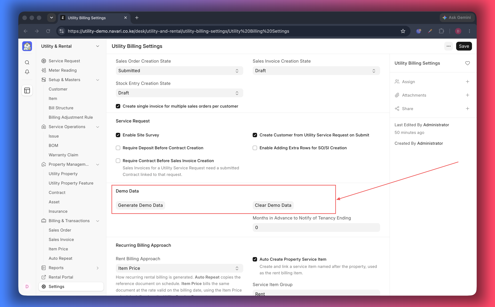
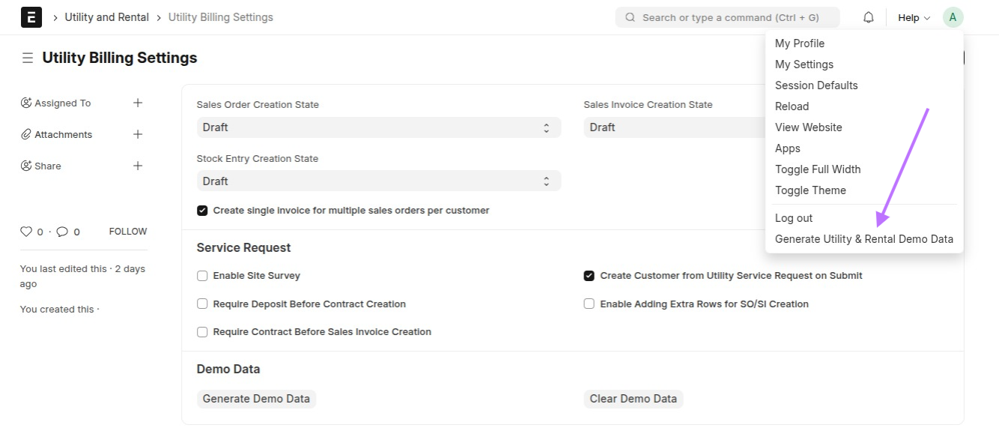

# 🧪 Demo Data for Utility Billing & Property Management

## Overview

The demo generator builds a complete, explorable dataset for the desk and the
Rental Portal. It creates a separate **Utility and Rental (Demo)** company, so
demo bills, contracts, meter readings and portal users stay isolated from your
production company.

> ⚠️ **Development and staging only.** Demo records share one documented
> password and use external image URLs. Do not enable demo accounts in
> production.

The generator is idempotent where it can be: existing master records are
skipped, generated serial numbers and support tickets are not duplicated, and
service requests/transactions are not recreated for properties already leased.

---

## 🎯 What Gets Created

| Area | Demo data |
| --- | --- |
| Customers | 12 residential and commercial customers |
| Portal users | 12 Website Users linked through `Customer.portal_users` |
| Properties | 6 buildings/estates and 26 lettable units |
| Images | Cover image + gallery for every property, using free Unsplash URLs |
| Service requests | 12 requests: 10 signed tenancies and 2 unsigned reservations |
| Contracts | One submitted Contract per request; signed where the request is signed |
| Rent pricing | Item Price schedules or Auto Repeat, depending on **Rent Billing Approach** |
| Utility pricing | Water, Electricity and Sewer Item Prices with tiered tariff blocks for residential and commercial price lists |
| Meter readings | 11 submitted readings across occupied units, generating meter Sales Orders |
| Sales Orders | Rent Sales Orders plus the Sales Orders generated by meter readings |
| Sales Invoices | One first-period rent invoice per leased property |
| Support tickets | 9 Issues linked to properties/requests, including replies and resolved examples |
| Billing rules | Three `Billing Adjustment Rule` examples (fixed, linear and compounding) |

The names, unit sizes, rents and lease dates are deterministic. Dates are
relative to the day the demo is generated, so the data does not become stale.

---

## 🏘️ Demo Properties and Images

The demo includes:

- **The Pinnacle Towers - Kilimani** – studio, one, two-bedroom and penthouse units
- **Kileleshwa Heights Apartments** – bedsitter to three-bedroom units
- **Greenpark Estate - Runda** – townhouses and a maisonette
- **Westlands Business Plaza** – office suites and a retail shop
- **Mombasa Beachfront Villas** – beachfront villas
- **Ruiru Garden Court** – affordable garden apartments

Every building and unit has a `cover_image` and a populated `image_gallery`.
The images are remote URLs from Unsplash, so the gallery works without
uploading files. The portal falls back to its initials placeholder when the
browser is offline or an image cannot be loaded.

---

## 👤 Sample Portal Accounts

Each account is a Website User with the `Customer` role, linked to its Customer
through `Customer.portal_users`.

**Password for every demo account:** `Demo@12345`

| Customer | Email |
| --- | --- |
| Wanjiku Kamau | `wanjiku.kamau@demo.utilitybilling.test` |
| Ochieng Otieno | `ochieng.otieno@demo.utilitybilling.test` |
| Daniel Mwangi | `daniel.mwangi@demo.utilitybilling.test` |
| Amina Hassan | `amina.hassan@demo.utilitybilling.test` |
| Faith Njeri | `faith.njeri@demo.utilitybilling.test` |
| Peter Omondi | `peter.omondi@demo.utilitybilling.test` |
| Brian Kiptoo | `brian.kiptoo@demo.utilitybilling.test` |
| Grace Achieng | `grace.achieng@demo.utilitybilling.test` |
| Nairobi Enterprises Ltd | `finance@nairobi-enterprises.demo.utilitybilling.test` |
| Mombasa Trading Co. | `accounts@mombasa-trading.demo.utilitybilling.test` |
| Savanna Retail Group | `leases@savanna-retail.demo.utilitybilling.test` |
| Kilimani Health Partners | `admin@kilimani-health.demo.utilitybilling.test` |

Sign in at `/rental-portal` with any account to exercise the tenant flows.

> Change or remove these accounts before using the dataset outside a demo or
> training environment.

---

## 💰 Pricing: Item Price vs Auto Repeat

The demo **does not change** `Utility Billing Settings → Rent Billing Approach`.
It follows the approach already configured on the site.

### Item Price approach

- Each leased property gets a dated **Item Price** schedule built from its lease
  start/end and its linked `Billing Adjustment Rule`.
- The schedule is scoped to the tenant Customer and the property's service item.
- Available units receive an open-ended base Item Price so the portal booking
  summary has a rent amount before a lease exists.
- First-period rent invoices are created at the Item Price valid on the invoice
  date. Sales Orders and Sales Invoices still honour the configured creation
  state (`Draft` or `Submitted`).

### Auto Repeat approach

- Every property receives a base rent Item Price.
- One first-period Sales Invoice is created per leased property, with an
  **Auto Repeat** document linked to it.
- The anchor invoice is submitted so the Auto Repeat schedule is runnable.
- The demo starts a historical lease's Auto Repeat from today (while keeping the
  Contract dates) to avoid an Auto Repeat whose first increment date has already
  passed.
- If `Sales Invoice` does not yet allow Auto Repeat, the demo applies the same
  setting as the app's `set_allow_auto_repeat_sales_invoice` patch.

### Meter readings and tariff blocks

Meter Item Prices are created for both **Standard Residential** and **Standard
Commercial** price lists. Water, Electricity and Sewer use tiered
`Item Price Tariff` rows (`Block 1`, `Block 2`, ...). Submitting a Meter Reading
therefore fills its read-only **Rates** table with one row per block and creates
a meter Sales Order.

---

## 📄 Contracts, Billing and Support Data

- Signed requests are submitted and marked `is_signed`, so their units appear as
  **Active** in the portal.
- Unsigned requests remain `Reserved` and still show in **My Bookings**.
- Rent Sales Orders carry the request link; rent Sales Invoices carry the request
  and property service item. Meter readings create their own Sales Orders.
- Support tickets cover open, replied, on-hold and resolved states. A few include
  a first support reply, so the portal conversation timeline is populated.
- Payment gateway accounts are **not** seeded. The portal payment action requires
  a configured `Payment Gateway Account` for the demo company.

---

## ⚙️ How to Generate Demo Data

### Option 1 – Utility Billing Settings

Open **Utility Billing Settings** and click **Generate Demo Data**.



### Option 2 – Toolbar quick action

Use the demo quick action from the app toolbar.



### Option 3 – Bench

```bash
bench --site <site> execute utility_billing.setup.demo.setup_demo_data
```

The operation is restricted to a **System Manager**.

#### 🎥 Video

<video src="./video/demo-data.mp4" width="600" controls>
  Your browser does not support the video tag.
</video>

---

## 🧹 Clearing Demo Data

Use **Clear Demo Data** from Utility Billing Settings or the toolbar, or run:

```bash
bench --site <site> execute utility_billing.setup.demo.clear_demo_data
```

Clearing removes:

- demo Sales Orders, Sales Invoices and Auto Repeats;
- meter readings, contracts, service requests and bill structures;
- demo support Issues and their comments;
- generated property Item Prices and property service items;
- demo portal Users and their `Customer.portal_users` links;
- demo master data and the **Utility and Rental (Demo)** company.

Only records belonging to the demo company/Customers are removed; manually
created data in other companies is untouched.

---

## ❗ Important Notes

- **Isolation:** all transactions are created under the demo company.
- **Not production data:** sample passwords and remote images are intentional.
- **Idempotency:** rerunning the generator skips existing Properties, Customers,
  leases, meter readings and support tickets instead of duplicating them.
- **Cleanup:** clear the demo before removing the app or reusing the site.
- **Portal visibility:** with the default `Draft` creation states, rent Sales
  Orders/Invoices remain drafts. Set them to `Submitted` in Utility Billing
  Settings before generating the demo if the portal billing pages should list
  them immediately. Auto Repeat mode always submits its anchor invoices.
- **Portal:** see [Customer Portal](./Customer-Portal.md) for every route and
  endpoint exercised by these records.

---

## 🚀 Quick Navigation

[](https://github.com/navariltd/utility-billing)
[](https://github.com/navariltd/utility-billing/wiki)
[](https://docs.erpnext.com)
[](https://frappeframework.com/docs)
[](https://discuss.frappe.io)
[](https://github.com/navariltd/utility-billing/issues)
[](https://navari.co.ke)
